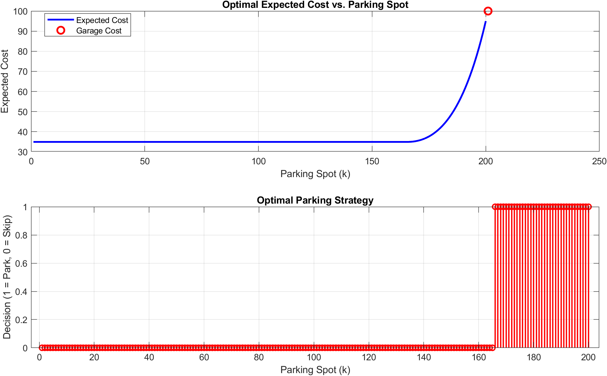
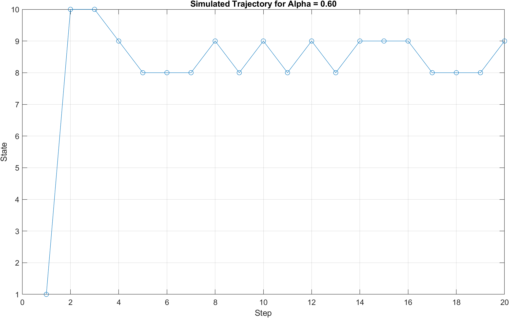
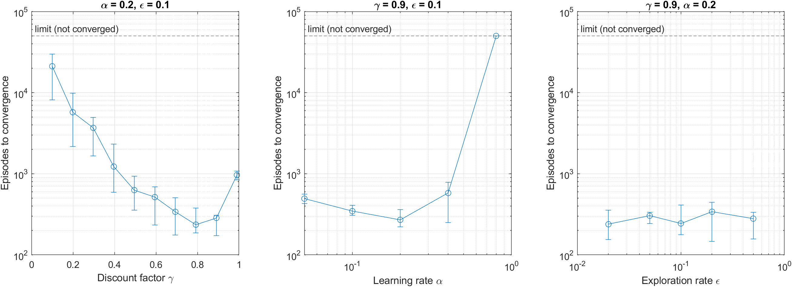
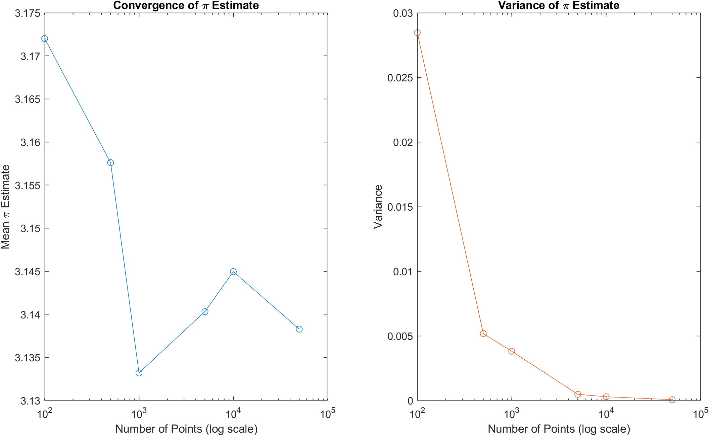

# Markov chains, dynamic programming, Q-learning and Monte Carlo (MATLAB)

This project solves four short problems about systems that involve chance. Each problem has a small MATLAB script, and a report in Greek explains the method and the results step by step.

It is Assignment 3 of the course *Neuro-fuzzy control and applications* (coursework, 2024-2025). Author: Konstantinos Vaios Chronis.

## The four problems in plain words

1. **A system that jumps at random (Markov chain).** A system has five states and jumps from one to another at random. The chance of each jump depends only on the state it is in now. Three numbers, a, b and c, set some of these chances (a, b, c ≥ 0 and a + b ≤ 1):
   - from state 1 to state 2 with chance 1 - a - b, to state 3 with chance a, and to state 4 with chance b;
   - from state 2 always to state 3;
   - from state 3 to state 4 with chance 1 - c, and to state 5 with chance c;
   - from state 4 always to state 1;
   - from state 5 to state 3 or back to state 5, each with chance 1/2.

   The questions are: which states the system keeps returning to, whether it moves in a fixed rhythm, where it is likely to be after 1,000 steps, and how much of its time it spends in each state.
2. **Where to park.** A driver passes 200 parking spots on the way to a garage. Each spot is free with probability 0.05. Parking at spot k costs 200 - k, so spots closer to the garage cost less, and the garage itself costs 100. The driver cannot turn back, and if they reach the garage they must park there. When the driver sees a free spot, should they take it or drive on?
3. **Steering a random walk.** A marker sits on one of 10 positions, and each position has a cost. The costs of positions 1 to 10 are 1, 2, 3, 4, 5, 4, 2, 0, 1 and 2. The assignment does not say what happens at the two ends, so this solution treats positions 1 and 10 as neighbours (a circle). At every step you push the marker left or right, and it moves that way with probability 1/2 (otherwise it stays). The goal is to keep the total cost low. Future costs count less than present ones, by a factor α (or γ) per step. This is solved twice: with value iteration, when the rules are known, and with Q-learning, when they are not and the controller has to learn by trial and error.
4. **Estimating π with random points.** Throw random points into a square and count how many land inside a quarter circle. That share, times 4, approaches π. How fast does the estimate improve as the number of points grows, and how much does it vary from one repetition to the next?

| Problem | Script(s) |
|---|---|
| 1. Markov chain | `MarkovChain1_2.m` (probabilities at t = 1000-1003), `MarkovChain1_3.m` (10,000-step simulation) |
| 2. Parking | `ask2_parkingex.m` |
| 3. Random walk | `problem_3_A.m` (value iteration), `trajectories_ask3_final.m` (simulated paths), `Q_learning.m` |
| 4. Monte Carlo | `MonteCarlo.m` |

## Results

All numbers and plots below come from running the code in this repository with MATLAB R2024b. They are the same as in the report.

**1. Markov chain.** Which states keep recurring and the rhythm (period) depend on a, b and c, and the report lists every case. Two cases are computed:

- With a = 0, b = 0.1, c = 0, state 5 is left for good and the other four states repeat in a rhythm of 2 steps. The probabilities never settle: they alternate between even and odd time steps.
- With a = b = c = 0.1, the probabilities settle at 0.25, 0.20, 0.25, 0.25 and 0.05 for states 1 to 5, whatever the starting state. This is the stationary distribution. A 10,000-step simulation spends 24.98%, 19.87%, 24.98%, 24.97% and 5.20% of its time in states 1 to 5, within 0.2 percentage points of it.

**2. Parking.** Drive past every spot up to spot 165, even if it is free. From spot 166 on, take the first free spot, that is, the first free spot that costs 34 or less. With this rule the expected cost is 34.93, far below the garage's 100. The method is dynamic programming: it works backwards from the garage and compares, at each spot, the price of parking with the expected cost of driving on.



**3. Random walk.** The best controller is the same for every discount factor tested (α from 0.1 to 0.9):

| Position | 1 | 2 | 3 | 4 | 5 | 6 | 7 | 8 | 9 | 10 |
|---|---|---|---|---|---|---|---|---|---|---|
| Push | left | left | left | left | right | right | right | right | left | left |

It steers the marker to position 8, the only one with zero cost, and avoids position 5, the most expensive one. It then keeps the marker at positions 8 and 9. A marker that starts at position 1 goes 1 → 10 → 9 → 8 and then stays at 8 and 9:



**Q-learning.** Here the controller does not know the moving rules or the costs. It learns from experience, in episodes of 10 steps that start at a random position. A run counts as converged when the learned controller is the best one and stays the best for 100 episodes in a row. Each setting was run 20 times, and the plot shows the median and the middle half of the runs:

- **Discount factor γ:** learning is slow when γ is small (median 21,137 episodes at γ = 0.1). When the future hardly counts, the two choices cost almost the same in some positions, and the learner keeps changing its mind. It is fastest around γ = 0.8-0.9 (236-286 episodes) and slower again at γ = 0.99 (966 episodes).
- **Learning rate α:** 0.2 is the fastest (271 episodes). Smaller rates learn steadily but slowly. Larger rates make the estimates swing: at α = 0.8, 18 of the 20 runs had not converged after 50,000 episodes.
- **Exploration rate ε:** little effect here (239-341 episodes for ε from 0.02 to 0.5).



**4. Monte Carlo.** Each estimate is repeated 10 times. With 100 points the mean estimate is 3.172, with a variance of 0.028. With 50,000 points it is 3.138, with a variance of 0.000067. Theory says the variance is π(4 - π)/N, about 2.7/N. So the error shrinks like 1/√N: 100 times more points make the error 10 times smaller.



## Run it

Open MATLAB in the `matlab/` folder and type the name of a script, for example:

```matlab
MarkovChain1_3
```

Each script runs on its own and prints its results. Scripts that use random numbers fix the random seed (`rng(0)`), so they print the numbers shown above. `Q_learning.m` takes about 20 seconds; the others take a few seconds or less. Checked with MATLAB R2024b. `trajectories_ask3_final.m` needs `randsample` from the Statistics and Machine Learning Toolbox.

## Repository contents

```
matlab/   the seven MATLAB scripts
report/   the full report (Greek): method, code excerpts, results and discussion
figures/  the plots shown in this README, made by running the code
```

## Sources and credits

- **Assignment.** The four problems are from Assignment 3 of *Neuro-fuzzy control and applications* (coursework, 2024-2025). The problem statement belongs to the course and is not included here. This README only summarizes it.
- **Parking problem.** Problem 2 is the parking example of D. P. Bertsekas (Example 1.3.3), as given in the assignment.
- **Own work.** The MATLAB code and the report are the author's own work for this assignment.
- **Tools.** [MATLAB](https://www.mathworks.com/products/matlab.html) and its Statistics and Machine Learning Toolbox.
- The university logo on the report's title page belongs to the university.

## License

None. This work is shared for viewing only, and all rights are reserved by the author.
